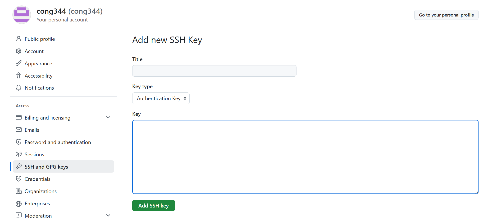
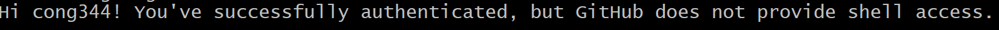
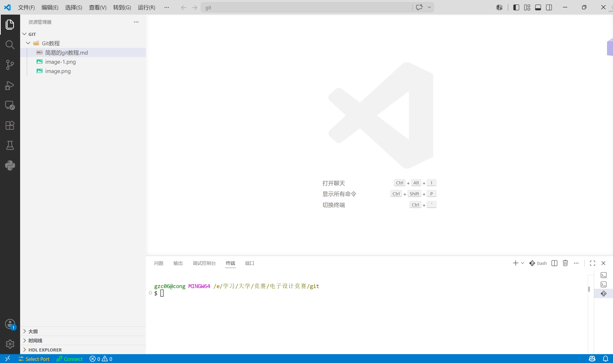

# Git的使用与协作
## Github的注册
访问 [Github官网](https://github.com) ，输入邮箱，填写用户名等信息后，即可注册自己的 Github 账号。

随后，我将发送电赛项目的协作邀请，在收到的电子邮件中点击同意即可。

## Git的下载
访问Windows版本的 [Git官网](https://gitforwindows.org/)，点击 Download 后即可下载安装程序。

下载完毕后打开安装程序，基本选择默认选项即可。可以参考 [知乎Github教程](https://zhuanlan.zhihu.com/p/369486197) 中的第六部分。

安装完毕后，在桌面或Windows菜单中将有 Git Bash 软件。进入软件后输入git不报错，说明下载成功。

## Git的配置
安装完 Git Bash 后，需要进行**初始化操作**。

在Git Bash中依次输入如下命令：

```
git config --global user.name "Your Name"
git config --global user.email "email@example.com"
```

其中，`Your Name` 是在团队协作中让他人识别你的标志，可以自拟名称。`email@example.com` 则填写你的邮箱。

## 绑定Git与Github
### 生成SSH Key
首先，在Git Bash中生成**SSH密钥**。输入`ssh-keygen -t rsa`命令，随后需要选择具体文件。在此处，直接按回车即可，表示默认路径。按3次回车后，SSH Key生成成功。

生成的SSH Key一般位于如下路径：`C:\用户\用户名\.ssh`
### 在Github中添加
在Github的右上角点击自己的头像，进入`Settings`。选择`SSH and GPG Keys`一项，并进入`New SSH Key`。

随后，无需输入标题，向Key栏中输入`id_rsa.pub`文件中的内容。如图所示。


连接成功后，打开Git Bash，输入`ssh -T git@github.com`。此时，可能要求等待继续连接，输入`yes`继续。

随后，出现如图所示的一行话，说明连接成功。


## Git的相关操作
### 工作区的初始化
对于一个项目的Git操作依赖于**工作区**。为了方便管理，将今后的所有代码统一存放在一个工作区中。

为了方便操作，通常可以使用VSCode来操作Git。操作如下：
- 在VSCode中打开存放项目的文件夹。
- 按 Ctrl + ` 组合键，打开中断。
- 点击右上角加号旁的小箭头，选择Git Bash。
此时，在VSCode下方的终端区便可随时输入git指令，如图所示。

随后，需要将寄存在Github上的教程下载到本地的工作区中，这个过程称为**clone**。

在VSCode终端中，输入如下指令：`git clone git@github.com:cong344/LiuZiYi_2026NUEDC.git`。随后，寄存在Github项目库中的所有文件将被下载到此文件夹中。

### Git项目结构与命令
在git中，一个项目存在不同**分支**，称为**branch**。由于分支的存在，使得团队协作中不会出现混乱。分支的示意图如下所示。

- 每一个白色圈圈是一个**版本**结点。当你完成了项目中的一个功能时，可以将现有的版本提交至本地仓库中。
- 蓝线`master`表示**主分支**。此分支用于最终可用的版本呈现，一般需要很谨慎的修改。
- 红线`dev`是**工作分支**。主要通过此分支进行测试，将不同成员的修改**合并**到此分支，合并过程称为**merge**。
- 绿线和黄线是**成员分支**。每个成员在此分支上修改，不会互相干扰。
### 具体使用流程
1. 在完成`clone`的文件夹中，输入`git switch -c name`命令，创建自己的工作分支。其中，`name`可以自己起。
2. 在分支中进行自己的程序更改。每次完成一个功能后，按照以下方法将修改添加至本地仓库中：首先输入命令 `git add 文件名.文件类型`，`add`后的文件即是你在这个版本所改动的文件。随后输入命令 `git commit -m "版本记录"` ，其中双引号中的内容用于说明你在这个版本进行了哪些改动。
3. 当改好了一部分功能，可以调试时，需要将自己的分支合并至团队的工作分支中。输入命令 `git checkout dev`，切换至工作分支。随后，输入 `git pull origin dev`，下载最新工作分支。最后，输入 `git merge name`，完成合并。（注意name是你自己起的名字）
4. 合并完成后，将现有的工作分支提交至github，输入命令 `git push -u origin dev` 即可。（注意：`-u`表示设置默认，下次提交 `dev`时直接输入 `git push` 即可）
